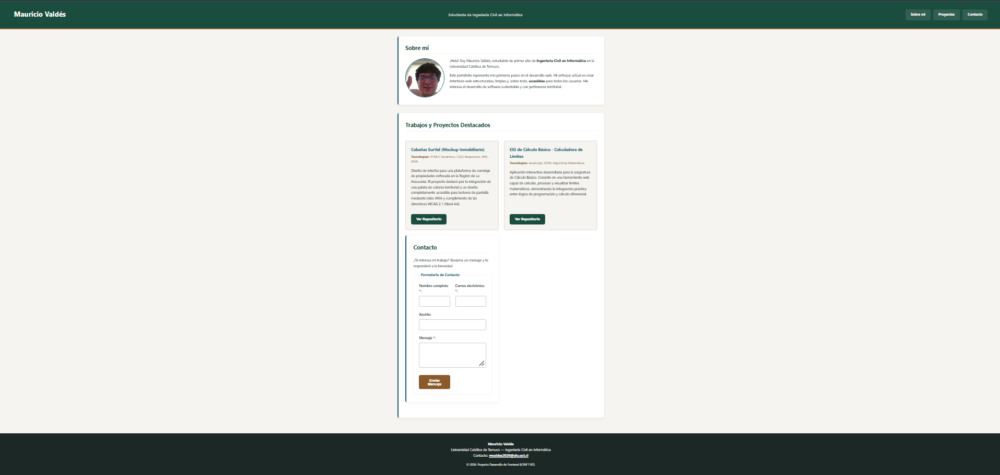

# Portafolio Profesional SPA — Evaluación N°4 (PIF)

Aplicación Single Page Application (SPA) desarrollada con **React**, **TypeScript** y **Vite**, correspondiente al Proyecto Integrado Final de la asignatura **Desarrollo de Frontend (ICINF1107)** de la Universidad Católica de Temuco.

* **Estudiante:** Mauricio Valdés
* **Carrera:** Ingeniería Civil en Informática — Universidad Católica de Temuco
* **Repositorio E4 (Actual):** https://github.com/mvaldes2026/evaluacion_4-mauricio_valdes
* **Repositorio E2 (Evidencia Original):** https://github.com/mvaldes2026/mvaldes2026-portafolio-frontend

---

## 1. Fidelidad Visual y Comparación con la Evaluación N°2

El portafolio en React conserva la arquitectura visual, la jerarquía de contenidos, la tipografía nativa y la paleta cromática territorial de La Araucanía entregadas en la Evaluación N°2:

* **Paleta cromática original:** Verde Araucanía (`#1B4D3E`), Azul Lago (`#1E5B70`), Madera Roble (`#8B5A2B`), Tierra Fondo (`#F6F4F0`) y Texto Principal (`#1C2826`).
* **Estructura visual:** Encabezado institucional superior, tarjetas principales con borde izquierdo acentuado (`0.375rem` en Azul Lago) y pie de página oscuro con información de contacto.

### Evidencia Visual del Portafolio Original (`docs/captura-e2.png`)



### Decisiones de Mejora Justificadas respecto a la E2
1. **Navegación SPA con React Router:** Se sustituyeron los enlaces internos mediante anclas (`#sobre-mi`, `#proyectos`, `#contacto`) por rutas declarativas (`/`, `/proyectos`, `/contacto` y ruta comodín `*` para errores 404), destacando la vista activa con `NavLink`.
2. **Corrección de maquetación en el formulario de contacto:** En la captura de la E2 (`docs/captura-e2.png`), aplicar CSS Grid directamente sobre `<fieldset>` provocaba que `<legend>` desplazara las columnas, generando saltos de línea en las etiquetas `Nombre completo *:` / `Correo electrónico *:` y comprimiendo el botón `Enviar Mensaje`. En la E4 se encapsularon los campos dentro de una lista semántica (`ul.contact-form__grid`), logrando una grilla simétrica y limpia.
3. **Interactividad declarativa y estado transversal:** Se incorporó un selector de modo claro/oscuro persistente en `localStorage` gestionado mediante `Context API` (`ThemeContext`), filtrado interactivo por tecnología en proyectos destacados y validación reactiva de formulario con retroalimentación accesible.

---

## 2. Arquitectura del Proyecto y Metodología CSS

```text
evaluacion_4-mauricio_valdes/
├── docs/
│   └── captura-e2.png              # Captura de referencia del portafolio original (E2)
├── public/
├── src/
│   ├── assets/
│   │   └── perfil.jpg              # Fotografía de perfil optimizada
│   ├── components/
│   │   ├── Footer/                 # Pie de página institucional (.footer)
│   │   ├── Navbar/                 # Encabezado y navegación SPA + tema (.navbar)
│   │   ├── ProjectCard/            # Tarjeta de proyecto académico (.project-card)
│   │   ├── RepoCard/               # Tarjeta de repositorio GitHub (.repo-card)
│   │   └── StatusMessage/          # Mensajes accesibles de estado (.status-message)
│   ├── context/
│   │   └── ThemeContext.tsx        # Estado global transversal para tema claro/oscuro
│   ├── data/
│   │   └── portfolioData.ts        # Datos estáticos tipados recuperados de E2
│   ├── hooks/
│   │   └── useFetchApi.ts          # Custom hook genérico con AbortController y caché
│   ├── pages/
│   │   ├── HomePage.tsx            # Ruta "/" (Sobre mí)
│   │   ├── ProjectsPage.tsx        # Ruta "/proyectos" (Proyectos E2 + API GitHub)
│   │   ├── ContactPage.tsx         # Ruta "/contacto" (Formulario validado)
│   │   └── NotFoundPage.tsx        # Ruta "*" (404 Not Found)
│   ├── services/
│   │   └── githubService.ts        # Configuración de endpoint GitHub REST API
│   ├── types/
│   │   └── index.ts                # Interfaces y tipos TypeScript estrictos (cero any)
│   ├── App.tsx                     # Configuración de ThemeProvider y BrowserRouter
│   ├── index.css                   # Variables CSS territoriales, reset y utilidades A11y
│   └── main.tsx                    # Punto de entrada de la aplicación
├── INVENTARIO.md                   # Trazabilidad detallada de migración E2 -> React
├── README.md                       # Documentación técnica ejecutable
└── uso_ia.md                       # Bitácora ética y técnica de uso de IA (6 secciones)
```

* **Metodología BEM:** Todos los estilos siguen estrictamente la nomenclatura `bloque__elemento--modificador` (ej. `.navbar__link--active`, `.status-message--error`, `.projects-section__filter-btn--active`).
* **Unidades relativas:** El CSS prescinde por completo de unidades fijas `px`, utilizando exclusivamente `rem`, `em` y porcentajes.

---

## 3. Contrato Técnico de la API REST Pública

### Endpoint Consumido
* **Servicio:** GitHub REST API v3 (pública, sin necesidad de API Key)
* **Método HTTP:** `GET`
* **URL:** `https://api.github.com/users/mvaldes2026/repos?sort=updated&per_page=6`
* **Parámetros utilizados:**
  * `sort=updated`: ordena los repositorios desde el modificado más recientemente.
  * `per_page=6`: limita la respuesta a un máximo de 6 repositorios públicos.

### Justificación de Elección
Se eligió la **GitHub REST API** porque permite sincronizar dinámicamente los repositorios públicos reales del estudiante dentro de la vista `/proyectos`, complementando los trabajos estáticos de la Evaluación N°2 sin exponer credenciales privadas en el frontend.

### Estructura JSON Esperada (Tipada mediante `interface GitHubRepo`)
```json
[
  {
    "id": 123456789,
    "name": "evaluacion_4-mauricio_valdes",
    "description": "Portafolio profesional SPA en React y TypeScript",
    "html_url": "[https://github.com/mvaldes2026/evaluacion_4-mauricio_valdes](https://github.com/mvaldes2026/evaluacion_4-mauricio_valdes)",
    "language": "TypeScript",
    "stargazers_count": 1,
    "updated_at": "2026-11-17T20:00:00Z"
  }
]
```

### Gestión de Estados, Caché y Prevención de Race Conditions
El hook personalizado `useFetchApi<T>` (`src/hooks/useFetchApi.ts`) implementa:
1. **Estado Cargando (`loading`):** Retroalimentación visual y accesible mediante `<output aria-live="polite">`.
2. **Estado Éxito (`data`):** Renderizado de tarjetas `<RepoCard />` con lenguaje principal, conteo de estrellas, fecha formateada con `<time>` y enlace externo seguro (`target="_blank" rel="noopener noreferrer"`).
3. **Estado Error (`error`):** Captura de errores de red o respuestas HTTP no exitosas (`!response.ok`) notificadas mediante `role="alert"`.
4. **Caché en memoria y limpieza:** Utiliza un `Map` (`responseCache`) para evitar peticiones HTTP duplicadas al navegar entre rutas y un `AbortController` en la función de limpieza (`cleanup`) de `useEffect` para cancelar peticiones pendientes al desmontar el componente.

---

## 4. Guía de Instalación, Ejecución y Construcción (Vite)

### Requisitos Previos
* **Node.js** v20 o superior y **npm** v10 o superior.

### Comandos del Ciclo de Vida
```bash
# 1. Clonar el repositorio
git clone [https://github.com/mvaldes2026/evaluacion_4-mauricio_valdes.git](https://github.com/mvaldes2026/evaluacion_4-mauricio_valdes.git)
cd evaluacion_4-mauricio_valdes

# 2. Instalar dependencias del proyecto
npm install

# 3. Iniciar servidor local de desarrollo (con Hot Module Replacement - HMR)
npm run dev

# 4. Verificar tipos TypeScript (tsc) y empaquetar para producción en carpeta dist/
npm run build

# 5. Previsualizar localmente la compilación de producción generada en dist/
npm run preview
```

---

## 5. Auditoría de Accesibilidad (WCAG 2.1 AA) y Diseño Responsivo

* **HTML5 Semántico estricto:** La interfaz evita contenedores genéricos `<div>` y `<span>`, estructurando todas las vistas mediante `<header>`, `<nav>`, `<main>`, `<section>`, `<article>`, `<figure>`, `<figcaption>`, `<output>`, `<dl>`, `<dt>`, `<dd>`, `<time>`, `<ul>`, `<li>`, `<fieldset>`, `<legend>`, `<address>` y `<footer>`.
* **Navegación por teclado y lectores de pantalla:** Incorpora enlace de salto rápido (`.skip-link`), anillo de foco visible de alto contraste (`:focus-visible` en `#D97706`), etiquetas `<label htmlFor="...">` explícitas y atributos ARIA dinámicos (`aria-pressed`, `aria-invalid`, `aria-describedby`, `aria-live`).
* **Diseño Responsivo Mobile-First:** Adaptable desde `320px` (`20em`) hasta escritorio mediante puntos de quiebre relativos en `48em` (Tablet) y `64em` (Desktop) sin desbordamiento horizontal.

### Resultados de Validación (Google Lighthouse — Compilación de Producción)

| Categoría Lighthouse | Puntaje Obtenido | Observaciones Técnicas |
| :--- | :---: | :--- |
| **Accesibilidad** | **100 / 100** | Contraste AA validado, jerarquía semántica (`h1` → `h2` → `h3`), labels vinculados y landmarks nativos. |
| **Buenas Prácticas** | **100 / 100** | Cero errores en consola, enlaces externos seguros con `rel="noopener noreferrer"` y consumo HTTPS. |
| **SEO** | **100 / 100** | Metadatos descriptivos en `index.html`, atributo `lang="es"` y enrutamiento rastreable. |
| **Rendimiento** | **99 / 100** | Empaquetado optimizado con Vite (`npm run build`), caché en memoria para API y CSS modular ligero. |